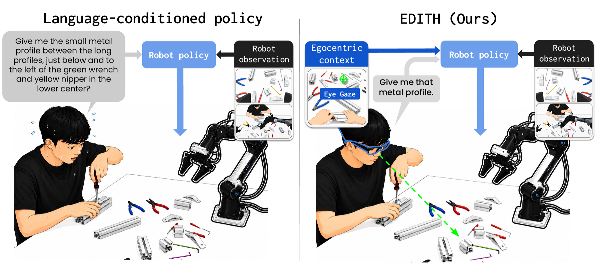

<div align="center">


# Teaching Robot to Follow Nonverbal Human Intent<br>from Egocentric Vision and Gaze

[Dongjun Lee](https://dgjun32.github.io/)<sup>\*1</sup> &middot;
[Juheon Choi](https://juheonchoi.com)<sup>\*1</sup> &middot;
[Dong Kyu Shin](https://donkeyu99.github.io/)<sup>\*1</sup> &middot;
[Sinjae Kang](https://sinjae.me/)<sup>1</sup> &middot;
[Kimin Lee](https://sites.google.com/view/kiminlee)<sup>1,2</sup>

<sup>1</sup>KAIST &nbsp;&nbsp; <sup>2</sup>Config &nbsp;&nbsp; <sup>\*</sup>Equal contribution

[](https://arxiv.org/abs/2606.10276)
[](https://project-edith.github.io)
[](https://www.projectaria.com/)

[](LICENSE)



</div>

## About the paper

EDITH lets a robot follow what a person **sees, looks at, and says**, captured
by smart glasses, instead of requiring a fully specified instruction.

- **About 2× the strongest baseline**: 48.6% average success vs. 25.0% for FAM-HRI, across three real-world tasks
- **Robust to distraction**: success holds when the human looks away (43.8% → 52.1%), while the baseline's nearly halves
- **Ego-view keyframes matter**: success drops from 43.8% to 2.1% without them

<details>
<summary>Main results (success / task progress %, 48 trials each)</summary>

| Method | Muffin-Serving | Tumbler-Sorting | Tool-Passing | **Average** |
| --- | :-: | :-: | :-: | :-: |
| π<sub>0.5</sub> (language only) | 0.0 / 12.2 | 0.0 / 26.2 | 12.5 / 31.3 | 4.2 / 23.2 |
| π<sub>0.5</sub> + egocentric context | 2.1 / 25.7 | 0.0 / 42.4 | 16.7 / 29.7 | 6.2 / 32.6 |
| VLM planner + π<sub>0.5</sub> (Hi Robot-style) | 2.1 / 15.6 | 4.2 / 36.5 | 14.6 / 40.6 | 6.9 / 30.9 |
| FAM-HRI + π<sub>0.5</sub> | 22.9 / 50.3 | 14.6 / 61.1 | 37.5 / 59.9 | 25.0 / 57.1 |
| **EDITH (ours)** | **43.8 / 70.8** | **39.6 / 77.8** | **62.5 / 79.2** | **48.6 / 75.9** |

</details>

## 1. Setup

Edith is an observation, policy, and recording layer above the robot repository.
Core capture has **no i2rt, ABC, or Piper SDK dependency**. Aria Gen 2 connects
by USB-NCM directly to this computer; robot cameras also connect locally.
USB-NCM carries IP traffic over the cable, so no Wi-Fi or external Aria server
is needed. Optional remote model services can still require network access.

Use Python 3.11 for the Gen 2 SDK:

```bash
uv venv .venv --python 3.11
uv pip install --python .venv/bin/python -e '.[aria,realsense,policies,replay]'
source .venv/bin/activate
aria_gen2 auth pair                  # one-time SDK pairing
cp configs/station.example.json configs/station.local.json
```

Edit the local station file with your RealSense serial numbers and joint groups.
`initial_state` supplies diagnostic state when motors are disabled; its JSON
key order defines the action vector order. Local station files are ignored by
Git. The default `robot.adapter: "none"` never initializes a robot controller.
At least one RealSense camera is required; `--sync-camera top` selects the
anchor. Use another configured camera name when appropriate.

```bash
edith-eval --station configs/station.local.json --check --headless
edith-dashboard --station configs/station.local.json
```

Do not run another program that owns the Aria stream or these cameras during
capture. The runner owns USB discovery, streaming, and shutdown. Optional
ABC/YAM control and GELLO teleoperation: [README_LOCAL_YAM.md](README_LOCAL_YAM.md).

## 2. The environment

```python
from edith.config import load_station
from edith.envs.local_env import LocalSensorEnv
from edith.eval_utils import RobotEvaluationEnv
from edith.robot_utils.noop import ConfiguredNoOpRobot

config = load_station("configs/station.local.json")
sensors = LocalSensorEnv(config)
robot = ConfiguredNoOpRobot(config)  # no robot SDK or motor connection
robot.start()
env = RobotEvaluationEnv(sensors, robot, robot.read(0))
try:
    obs = env.get_policy_observation()
finally:
    env.safe_end()
```

| Key | Shape | Contents |
| --- | --- | --- |
| `images["aria_rgb"]` | `(H, W, 3)` uint8 RGB | Glasses view |
| `gaze_point` | `(2,)` | Calibrated gaze pixel; NaN when invalid |
| `hand_keypoints["left" / "right"]` | `(21, 2)` | Projected hand landmarks; NaN when unavailable |
| `audio["samples"]` | `(N, C)` int32 | All available microphone frames since the previous observation, through the anchor time |
| `audio["sample_rate_hz"]` | integer | Actual rate derived from capture timestamps, not a fixed 48 kHz assumption |
| `audio["capture_timestamps_ns" / "source_timestamps_ns"]` | `(N,)` | Host-mapped / device capture time for each audio frame |
| `audio["muted"]` | `(N,)` | Device microphone mute flags |
| `aria_perception` | dict | Named raw eye-gaze (35) and hand-pose (156) values |
| `images["top_camera_rgb" / "left_wrist_camera_rgb" / "right_wrist_camera_rgb"]` | `(H, W, 3)` | Default station views; custom cameras use `<name>_rgb` |
| `robot_state` | `(D,)` | Joint groups flattened in station order |
| `robot_state_by_arm`, `arm_order` | dict, tuple | Original groups and their order (names need not be left/right) |
| `capture_timestamps_ns`, `source_timestamps_ns`, `sequence_numbers` | dict | Timing evidence for every stream |

Audio preserves all channels, the SDK amplitude scale (`max_amplitude`), and
`dropped_samples`. The tested Gen 2 profile delivered 8 channels at 16 kHz.
Empty intervals have zero frames; they are not invented silence. Replay inserts
silence at timestamp gaps. Audio reaches the local policy observation, but the
bundled learned policies use text through `--transcript-file`; they do not
transcribe or forward raw PCM to OpenPI automatically.

The synchronizer maps Aria TicSync and RealSense capture clocks to host
`perf_counter_ns`, selects camera/perception bundles within 100 ms, and rejects
stale frames. At 15 Hz, a 30 Hz anchor supplies every second frame; lower-rate
Aria streams may repeat their nearest sample. This is software alignment, not
a shared hardware exposure trigger. Audio is drained continuously by timestamp
rather than selecting one microphone chunk per image.

With motors disabled, `robot_state` is the configured initial pose, **not
measured encoder state**. Recording metadata identifies this explicitly.

## 3. Zero-action observation recording and replay

`zero_action_policy` returns a zero vector matching `robot_state`. It is a
diagnostic policy: absolute zero joint positions could move a real robot,
so its `observe_only` manifest makes the runner reject `--execute-actions`.
No robot adapter or robot SDK is loaded during this run.

```bash
edith-collect --station configs/station.local.json \
  --duration 20 --headless --output recordings/check/observations.h5

# Equivalent explicit policy invocation:
edith-eval --station configs/station.local.json \
  --policy-dir policies/zero_action_policy \
  --duration 20 --headless --output recordings/check2/observations.h5

edith-replay recordings/check/observations.h5 \
  --output-dir recordings/check/replay --play
```

Replay exports a four-view `replay.mp4` with audio, `audio.wav`, a preview, and
`verification.json` (audio gaps/mutes, RMS per channel, zero-action check, gaze
validity, and maximum camera/perception timestamp spread). `--play` uses a
local OpenCV window and ALSA `aplay`; without it, open the MP4 in a media player.
The replay mixes no channels: it uses microphone 0 with a reported playback
gain, while HDF5 retains unmodified multichannel int32 PCM.

HDF5 schema `edith.observations.v3` stores JPEG camera frames, raw perception,
robot state, audio, timestamps and sequence numbers. `audio/pcm` is a variable
length array per row, reshaped as `(-1, num_channels)`, with per-frame capture
and source timestamps and mute flags. `policy_observation` saves the state,
gaze/hand pixels, policy output, and text/timing metadata actually passed through
the policy loop, including its first invocation. Images in recordings are JPEG
encoded; the in-memory policy input remains RGB. Read only rows below the root
`complete_rows` attribute after interruption. Existing recordings are never
overwritten, and routine recordings are ignored by Git. A complete recorded
[example with video/audio replay, raw data, and a reading guide](examples/zero_action_observations/README.md)
is included under `examples/zero_action_observations/`.

## 4. Connect another robot repository

Implement `RobotAdapter` in the robot's own repository, install that package
alongside Edith, and set the station's factory path:

```json
"robot": {"adapter": "my_robot_repo.edith_adapter:create_robot", "config": {}}
```

The factory receives `config` as a keyword dictionary and returns an
`edith.robot_utils.RobotAdapter`. See the runnable, in-memory three-joint
[example](examples/robot_adapter.py). No edit to Edith's factory is needed.

| Adapter member | Contract |
| --- | --- |
| `arm_order`, `action_size` | Match station `initial_state` key order and total dimension |
| `start()` | Initialize the robot; factory construction must not enable motors |
| `read(timeout)` | Return `RobotSnapshot(positions, timestamp_ns)` in host `perf_counter_ns`; honor the timeout |
| `command(action)` | Accept one finite joint-position vector in the documented robot units |
| `close()` | Stop/release owned resources; safe after partial startup |

State polling and command refresh run on separate threads. The adapter must
serialize its driver as needed, map device clocks to the host clock, and enforce
robot-specific limits/watchdogs. The runner waits for synchronized sensors
before starting the adapter, polls live state into the same synchronizer, and
bounds the first target against the startup pose. An adapter may perform its
own startup/calibration motion in `start()`; consult its robot repository.

To execute a compatible policy, explicitly add `--execute-actions`. Without
that flag the factory is never imported and the configured no-op state is used.
`--robot module:factory` overrides the station selection. The optional
`--robot abc-yam` compatibility adapter loads the ABC station profile instead
of station JSON and requires that robot's environment; see the YAM guide.

Changing robot drivers does not convert a checkpoint's joint conventions,
normalizers, gripper units or camera inputs. Core capture and diagnostic
policies support arbitrary joint groups; the five supplied learned policy
clients still enforce their **14-value bimanual YAM** model contract.

## 5. Training and evaluation

Training code and model checkpoints are not included. Train a compatible
policy outside this repository and serve it through OpenPI, typically on
`ws://127.0.0.1:8000`. [policies/README.md](policies/README.md) describes the
checkpoint metadata and observation/action requirements.

| Policy directory | Purpose |
| --- | --- |
| `policy_edith` | Robot views/state plus ego-view keyframe and subtask |
| `fam_hri` | Gaze- and speech-based intent inference baseline |
| `vlm_textvla` | VLM planner and text-only VLA baseline |
| `streamvla` | Robot views/state, text and gaze-cropped Aria view |
| `textvla` | Robot views/state and text |
| `static_hold` | Repeat the startup joint-position target |
| `zero_action_policy` | Record observation flow with zero outputs and no robot execution |

```bash
edith-eval --station configs/station.local.json \
  --policy-dir policies/policy_edith \
  --policy-config policies/policy_edith/presets/passing_tools.json --headless
```

To add a policy, provide `policy.json` and `policy.py` under a policy directory:

```json
{"schema": "edith.policy.v1", "name": "my-policy", "entrypoint": "policy.py:Policy",
 "control_hz": 15, "action_space": "joint_position", "config": {}}
```

```python
class Policy:
    def __init__(self, policy_dir, config):
        pass

    def act(self, obs):
        return obs["robot_state"].copy()  # one (D,) target, not an action chunk
```

Run hardware-free validation with `.venv/bin/python -m unittest discover -s
tests -v`. Legacy ABC integration checks are opt-in via `EDITH_TEST_ABC=1` in
an ABC-equipped environment; core tests run without any robot SDK.

## Citation

```bibtex
@article{lee2026hierarchicalpoliciesverbalegocentric,
      title={Teaching Robot to Follow Nonverbal Human Intent from Egocentric Vision and Gaze},
      author={Dongjun Lee and Juheon Choi and Dong Kyu Shin and Sinjae Kang and Kimin Lee},
      year={2026},
      url={https://arxiv.org/abs/2606.10276},
}
```
