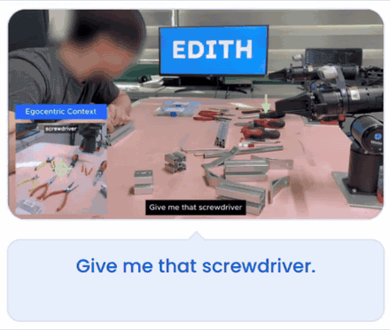
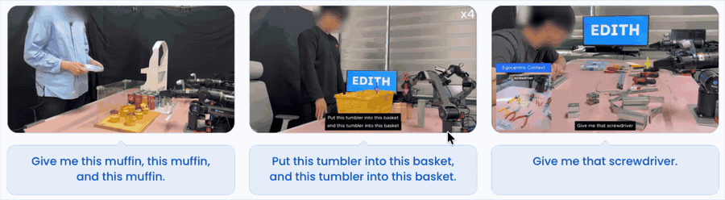

<div align="center">


# EDITH: Teaching Robot to Follow Nonverbal Human Intent from Egocentric Vision and Gaze

**A framework enabling robots to see what you see.**

[](https://project-edith.github.io)
[](https://arxiv.org/abs/2606.10276)
[](https://www.projectaria.com/)

[](LICENSE)



</div>

A person's egocentric view, eye gaze, and hand pose carry much of what a robot
needs to interact and collaborate with them: what they are doing, what they are
attending to, and what they want next.

EDITH is a framework that uses [Project Aria Gen 2](https://www.projectaria.com/)
glasses to stream these signals, along with the person's speech, into the robot's
input in real time. It covers the [hardware setup](#1-setup),
[data collection](#3-data-collection-coming-soon-), and
[policy training](#policy-training)
and [deployment](#5-policy-evaluation).

In our paper, we designed a hierarchical policy that understands human intent
from speech complemented by nonverbal signals
([Section 4](#4-hierarchical-policies-following-nonverbal-instructions-coming-soon-)).
There are many more use cases, and we hope this framework enables many more
experiments.

## 1. Setup

```bash
git clone --recurse-submodules https://github.com/dgjun32/edith.git && cd edith
uv venv .venv --python 3.11
uv pip install --python .venv/bin/python -e '.[aria,realsense,policies,replay]'
source .venv/bin/activate

aria_gen2 auth pair                                                # pair the glasses once
cp configs/station.example.json configs/station.local.json         # set camera serials and joints
edith-eval --station configs/station.local.json --check --headless # device check
edith-dashboard --station configs/station.local.json               # live view
```

If you cloned without `--recurse-submodules`, run `git submodule update --init`.
YAM control and GELLO teleop: [README_LOCAL_YAM.md](README_LOCAL_YAM.md).
Other robots: implement a `RobotAdapter` ([example](examples/robot_adapter.py)).

## 2. The environment

A typical robot environment observes only the robot's cameras and joints. Here the
observation also includes the human: their **real-time egocentric view, gaze,
hands, and speech audio**, synchronized with the robot's cameras and joint state.

```python
from edith.config import load_station
from edith.envs.local_env import LocalSensorEnv
from edith.eval_utils import RobotEvaluationEnv
from edith.robot_utils.noop import ConfiguredNoOpRobot

config = load_station("configs/station.local.json")
robot = ConfiguredNoOpRobot(config)  # no motor connection
robot.start()
env = RobotEvaluationEnv(LocalSensorEnv(config), robot, robot.read(0))
try:
    obs = env.get_policy_observation()
finally:
    env.safe_end()
```

| Key | Shape | Contents |
| --- | --- | --- |
| `images["aria_rgb"]` | `(H, W, 3)` | Human's first-person view |
| `gaze_point` | `(2,)` | Gaze pixel in `aria_rgb` (NaN if invalid) |
| `hand_keypoints["left" / "right"]` | `(21, 2)` | Hand landmarks in `aria_rgb` |
| `audio["samples"]` | `(N, C)` | Microphone audio since the last observation: N samples × C channels at `audio["sample_rate_hz"]` |
| `images["top_camera_rgb" / "left_wrist_camera_rgb" / "right_wrist_camera_rgb"]` | `(H, W, 3)` | Robot cameras |
| `robot_state` | `(D,)` | Joint positions (the configured initial pose while motors are off) |
| `capture_timestamps_ns` | dict | Capture time of each stream |

All streams share one clock and are aligned within 100 ms at 15 Hz.

## 3. Data collection (Coming soon) 🚧

```bash
edith-collect --station configs/station.local.json --duration 20 --headless \
  --output recordings/ep0/observations.h5
edith-replay recordings/ep0/observations.h5 --output-dir recordings/ep0/replay
```

Every observation stream is saved to HDF5; replay exports a video with audio.
Example recording: [examples/zero_action_observations](examples/zero_action_observations/README.md).

## 4. Hierarchical policies following nonverbal instructions (coming soon) 🚧

<div align="center">

</div>

Our paper uses this setup to make a robot follow a person's real-time nonverbal
instructions: what they look at, point to, and say, as in "give me that".

**Teaching Robot to Follow Nonverbal Human Intent from Egocentric Vision and Gaze**<br>
[Dongjun Lee](https://dgjun32.github.io/)\*, [Juheon Choi](https://juheonchoi.com)\*,
[Dong Kyu Shin](https://donkeyu99.github.io/)\*, [Sinjae Kang](https://sinjae.me/),
[Kimin Lee](https://sites.google.com/view/kiminlee) (KAIST, Config; \*equal contribution)<br>
[Project page](https://project-edith.github.io) · [arXiv](https://arxiv.org/abs/2606.10276)

### Data preprocessing

Coming soon: turning recorded episodes ([Section 3](#3-data-collection-coming-soon-))
into training data.

### Policy training

Coming soon: training code and checkpoints for the EDITH policy. Until then,
train a model elsewhere (e.g. π<sub>0.5</sub> with OpenPI), serve it at
`ws://127.0.0.1:8000`, and evaluate it as in [Section 5](#5-policy-evaluation).

## 5. Policy evaluation

Every policy, from a single end-to-end model to a hierarchical planner +
controller, implements one class: [`edith.policies.BasePolicy`](edith/policies/base.py).
`edith-eval` calls it with the [Section 2](#2-the-environment) observation every
step and sends the returned joint targets to the robot environment.

Start from the template, a directory with `policy.json` and `policy.py`:

```bash
cp -r edith/policies/template my_policy
edith-eval --station configs/station.local.json --policy-dir my_policy --headless
```

```python
from edith.policies import BasePolicy

class Policy(BasePolicy):
    def act(self, obs):            # required: called every step
        return obs["robot_state"]  # one (D,) joint target, in robot_state order

    # optional: __init__(policy_dir, config) to load models,
    #           reset(obs) for the first observation, close() at the end
```

- `act` must return within one step (66 ms at 15 Hz). Run slow models such as
  planners and VLMs in a background thread and return the latest target; the
  runner keeps re-sending it to the robot in the meantime.
- Return one action per call. If your model predicts action chunks, buffer them
  inside the policy.
- `obs` also carries `instruction` and, when given, `transcript`
  (`--transcript-file`) and `policy_event` (`--policy-events-file`).

`policy.json` tells the runner which class to load and how to call it:

```json
{"schema": "edith.policy.v1", "name": "my-policy", "entrypoint": "policy.py:Policy",
 "control_hz": 15, "action_space": "joint_position", "config": {}}
```

| Field | Meaning |
| --- | --- |
| `entrypoint` | `file.py:ClassName` inside the directory (helpers: `from .helper import x`) |
| `control_hz` | How often `act` is called; must divide the anchor camera FPS (30 → 30, 15, 10, …) |
| `action_space` | Always `joint_position` (absolute joint targets) |
| `config` | Passed to `__init__`; override with `--policy-config file.json` |
| `observe_only` | Optional; `true` forbids `--execute-actions` |

Bundled policies in [`edith/policies`](edith/policies) also run by name, e.g.
`--policy-dir policy_edith`: the hierarchical example, where a Gemini planner
queues keyframe-grounded subtasks for a low-level VLA, built on
[`edith/policies/common`](edith/policies/common).

Without `--execute-actions` the arms never move: sensors and the policy run, and
actions are only checked (and recorded with `--output`). With it, the robot
starts, and the first action must be within 0.05 of the current pose
(`--max-first-action-delta`).

## Citation

```bibtex
@article{lee2026hierarchicalpoliciesverbalegocentric,
      title={Teaching Robot to Follow Nonverbal Human Intent from Egocentric Vision and Gaze},
      author={Dongjun Lee and Juheon Choi and Dong Kyu Shin and Sinjae Kang and Kimin Lee},
      year={2026},
      url={https://arxiv.org/abs/2606.10276},
}
```
