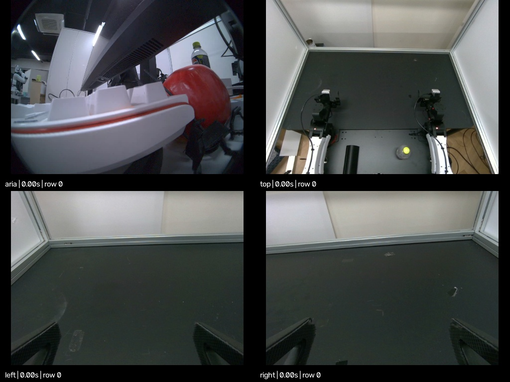

# Recorded zero-action observations

This is a complete 15-second capture from directly connected Aria Gen 2 glasses
and three RealSense robot cameras, using `policies/zero_action_policy`. It shows
the observation data available to the local policy runner. No robot driver was
loaded and no motor commands were sent.

[](replay.mp4)

**[Video replay with audio](replay.mp4)** · [Replay audio WAV](audio.wav) ·
[Verification report](verification.json) · [Checksums and provenance](manifest.json)

Download the MP4 to watch the four synchronized views with audio. It uses
microphone channel 0 with a 16× playback gain. The HDF5 preserves the original
eight-channel int32 PCM without playback gain. The WAV is the same mono track
used in the replay, not the full raw microphone data.

## What this recording contains

| Property | Recorded value |
| --- | --- |
| Capture date | 2026-10-27, Asia/Seoul |
| Observation rows | 229, all retained |
| Camera timeline | 15.270 seconds, approximately 15 Hz |
| Camera views | Aria RGB, top, left wrist, right wrist |
| Audio | 270,720 frames × 8 channels, 16 kHz, int32 PCM |
| Audio continuity | No detected source timestamp gaps or buffer drops; no mute flags |
| Policy output | 14 zeros on every observation |
| Maximum camera/perception timestamp spread | 99.954 ms |
| Robot state | Configured initial pose; **not measured joint positions** |
| Gaze | Invalid throughout this clip; projected gaze is NaN |

The first audio interval includes microphone frames collected before the first
accepted camera bundle. Consequently, raw audio spans 16.92 seconds; the replay
trims it to the camera timeline using capture timestamps. Lower-rate Aria image
and perception samples may repeat across adjacent rows with their original
timestamps and sequences. This is software alignment within a tolerance, not
simultaneous hardware-triggered exposures.

This example demonstrates storage and observation flow. It does not demonstrate
successful gaze tracking, learned policy behavior, or live robot feedback.
Missing gaze/hand projections remain NaN rather than being replaced with valid
coordinates. The `leader_*_actions` groups contain diagnostic policy targets;
there were no physical GELLO leaders in this run.

## Open the complete dataset

The full HDF5 is about 150 MiB uncompressed. Its lossless XZ archive is about
104 MiB, divided into four parts under `archive/` (at most 32 MiB each). All
parts are ordinary Git files; no Git LFS, robot SDK, or device is needed.

From the repository root:

```bash
python3 examples/zero_action_observations/unpack.py
```

The unpacker verifies every part and the reconstructed file against SHA-256
checksums. It writes `examples/zero_action_observations/observations.h5` and
refuses to overwrite an existing file. You can choose another destination with
`--output /path/to/observations.h5`. Allow about 255 MiB for the archive plus
the extracted recording. Extracted `.h5` files are ignored by Git.

The data uses schema `edith.observations.v3`. All sensor and policy arrays are
unchanged from the capture. Only descriptive metadata was edited for sharing:
camera serial numbers became placeholders, the policy path became relative,
and the `top` synchronization anchor was recorded explicitly.

## Inspect an observation

Install Edith as described in the [main README](../../README.md), then run:

```python
import json
import h5py
import numpy as np
import cv2

with h5py.File("examples/zero_action_observations/observations.h5", "r") as f:
    print(f.attrs["schema"], int(f.attrs["complete_rows"]))
    row = 100
    # Stored JPEG decodes to BGR; the live policy receives RGB.
    aria_rgb = cv2.cvtColor(
        cv2.imdecode(f["aria/rgb_jpeg"][row], cv2.IMREAD_COLOR),
        cv2.COLOR_BGR2RGB,
    )
    channels = int(f["audio"].attrs["num_channels"])
    pcm = f["audio/pcm"][row].reshape(-1, channels)  # int32, frames × channels
    rate = int(f["audio"].attrs["sample_rate_hz"])
    audio_times = f["audio/frame_capture_timestamps_ns"][row]
    state = f["policy_observation/robot_state"][row]
    action = f["policy_observation/action"][row]
    inputs = json.loads(f["policy_observation/metadata_json"][row])
    assert len(audio_times) == len(pcm)
    assert np.all(action == 0)
    print("RGB:", aria_rgb.shape, "PCM:", pcm.shape, "rate:", rate)
    print("state:", state, "action:", action)
    print("policy input keys:", inputs)
```

| HDF5 path | Contents |
| --- | --- |
| `aria`, `top`, `left`, `right` | Per-row JPEG bytes, capture/source/receive timestamps, sequence numbers |
| `eye_gaze/values` | 35 raw gaze values; names in the group's `value_fields` attribute |
| `hand_pose/values` | 156 raw hand-pose values; names in `value_fields` |
| `audio/pcm` | Variable-length flattened int32 PCM per observation |
| `audio/frame_capture_timestamps_ns` | Host-mapped capture time for every microphone frame |
| `audio/frame_source_timestamps_ns` | Original device time for every microphone frame |
| `audio/frame_muted` | Per-frame microphone mute flags |
| `follower_left_state`, `follower_right_state` | Configured seven-value poses, not encoders |
| `leader_left_actions`, `leader_right_actions` | Diagnostic zero outputs, not physical leader measurements |
| `policy_observation` | Flat state/actions, projected gaze/hands, text/timing metadata and image-key list |

Read only rows below the root `complete_rows` attribute. Capture and receive
timestamps use the host monotonic clock in nanoseconds. Source timestamps retain
their original domain: Aria device time or RealSense global wall time. Audio
contains all available unread frames captured at or before the observation
anchor; its frame timestamps show the actual coverage. It is not nearest-frame
sampled like images. See the [observation contract](../../README.md#2-the-environment).

To generate another replay directly from the unpacked data:

```bash
.venv/bin/edith-replay examples/zero_action_observations/observations.h5 \
  --output-dir recordings/example_replay --play
```

Playback requires a display and ALSA `aplay`. Omit `--play` to export the files
without opening a window. Replay imports no robot adapter and sends no actions.
